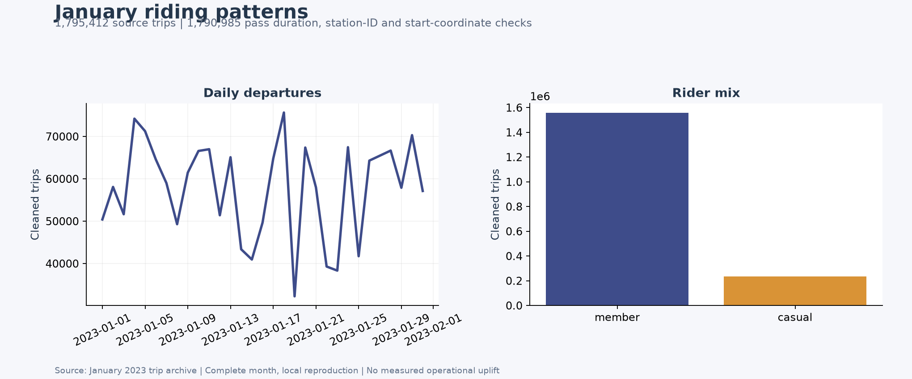
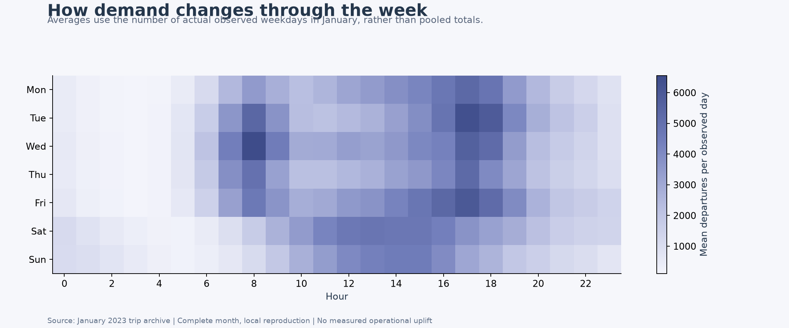
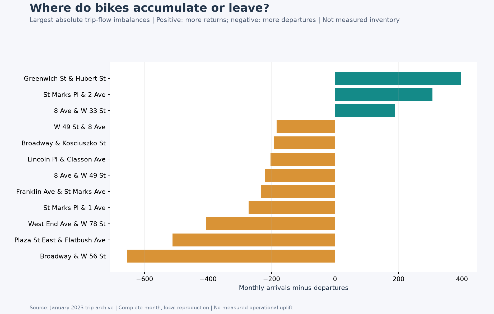
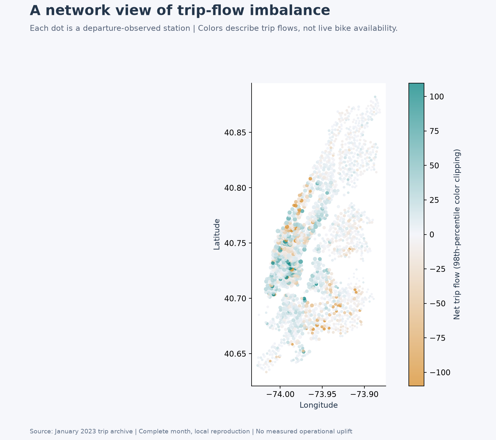
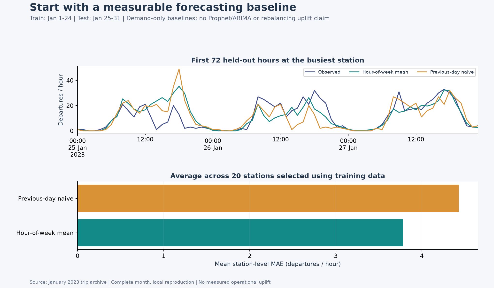

# NYC Citibike Demand and Rebalancing Analysis

Understand when riders need bikes, identify station-level trip-flow imbalances, and establish a reproducible forecasting baseline before designing rebalancing policies.


## Why this problem matters

A station can have strong daily demand yet still accumulate too many bikes or lose them faster than they return. Trip history helps identify these patterns and create inputs for a rebalancing model. Capacity, live inventory, truck availability, and travel constraints are also needed to turn those signals into feasible bike movements.

## What was rerun

The local reproduction processes the **complete January 2023 archive**, including both CSV members. The downloaded ZIP's SHA-256 is checked against the original repository's LFS pointer.

| Measure | Local result |
|---|---:|
| Source trips | 1,795,412 |
| Trips passing the documented cleaning rules | 1,790,985 |
| Retained share | 99.75% |
| Observed station IDs | 1,763 |
| Stations in the forecast evaluation | 20 |

The workflow filters duration to 1-1,440 minutes, requires station IDs, and checks start coordinates against NYC bounds. Hourly departures and arrivals are outer-joined so an arrival-only station-hour is retained. Monthly views are then clipped to January; a small number of archive-boundary trips can therefore contribute a January arrival but an earlier departure.





## Station-level flow imbalance

Net flow equals arrivals minus departures. Positive values indicate more trip returns than starts; negative values indicate more starts than returns. These are trip-flow signals, not observed station inventory or a count of bikes to move.





[Explore the interactive map](https://raw.githack.com/xkong585/NYC-citibike-Intelligent-Rebalancing/main/results/refreshed/station_balance_map.html) · [Download map HTML](results/refreshed/station_balance_map.html) · [Inspect station totals](results/refreshed/station_totals.csv)

## Forecasting before optimization

Twenty stations are selected by departure volume **using training dates only**. Each station is reindexed to a complete hourly calendar, including zero-demand hours.

- Training: January 1-24, 2023.
- Held-out evaluation: January 25-31.
- Hour-of-week baseline: mean departure count for each weekday/hour combination, fitted only on training dates.
- Previous-day baseline: use the departure count observed 24 hours earlier; this comparator updates as daily observations become available.
- Metrics: unweighted mean of the station-level MAE and RMSE over the same 168 test hours per station.

| Baseline | MAE, departures/hour | RMSE, departures/hour |
|---|---:|---:|
| Hour-of-week mean | 3.781 | 5.556 |
| Previous-day naive | 4.430 | 6.574 |



This is a one-month, demand-only benchmark. It does not establish annual forecast accuracy, weather-adjusted performance, reduced operating cost, or realized service improvement.

## Reproduce locally

```bash
git clone https://github.com/xkong585/NYC-citibike-Intelligent-Rebalancing.git
cd NYC-citibike-Intelligent-Rebalancing
python3.12 -m venv .venv
source .venv/bin/activate
pip install -r requirements-reproduction.txt
python scripts/download_data.py
python scripts/reproduce.py --data data/raw/202301-citibike-tripdata.zip
```

The source archive is about 335 MiB and is kept outside Git. The downloader verifies its checksum. The [executed notebook](notebooks/Local_Reproduction.ipynb) and [run summary](results/refreshed/run_summary.json) record the local results.

## What is in the original export

The supplied Databricks preprocessing notebook contains Spark/Delta data preparation. Its four later DBC exports contain empty code cells. The original README describes a broader roadmap involving forecasting, inventory simulation, routing, and a dashboard; the local reproduction does not treat those descriptions as completed implementations. The original performance percentages are preserved only in the [archived original README](docs/ORIGINAL_README.md), not presented as verified results here.

## Repository guide

- `scripts/download_data.py`: fetch and verify the original January archive.
- `scripts/reproduce.py`: clean trips, aggregate station-hour flows, evaluate baselines, and draw figures.
- `notebooks/Local_Reproduction.ipynb`: executed local workflow.
- `notebooks/*.dbc`: original Databricks exports.
- `notebooks/exported_source/`: readable Python exports for source inspection.
- `results/refreshed/`: new figures, forecast metrics, and aggregate CSVs.
- `data/lfs_pointers/*.txt`: original archive checksum/size manifests, preserved without broken LFS downloads.
- `docs/REPRODUCTION.md`: scope, assumptions, and improvements.

## Next steps

Extend evaluation to multiple seasons, add station capacity and historical inventory, compare stronger demand models, and evaluate feasible truck routes against a defined baseline. Only after those steps should rebalancing benefit claims be made.
